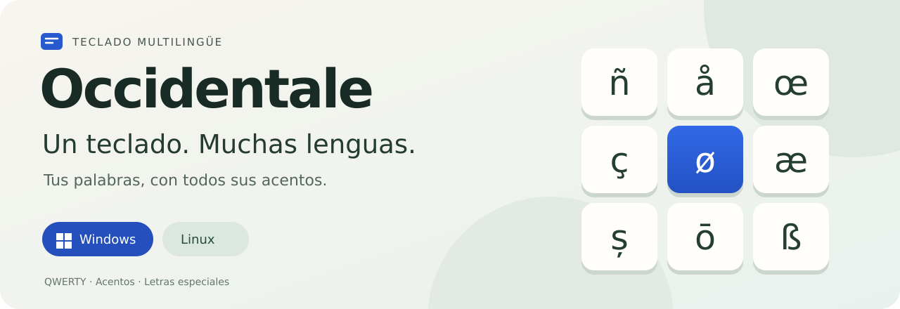

# Occidentale



**Escribe en varias lenguas sin cambiar de teclado.** Acentos, eñes, cedillas y letras como **å, ø, œ, æ, ș y ß**, con combinaciones fáciles de recordar.

**[📥 Descargar el proyecto](https://github.com/Emilianowv/Occidentale/archive/refs/heads/main.zip)** · **[🪟 Windows](windows/README.md)** · **[🐧 Linux](docs/INSTALACION.md)** · **[⌨️ Guía de teclas](docs/TECLAS.md)**

## Un teclado para tus idiomas

Escribe **español, português, français, italiano, Deutsch, svenska, norsk, română** y muchas otras lenguas europeas con alfabeto latino. Occidentale conserva las letras QWERTY y reúne los caracteres especiales en un mismo lugar.

| Para escribir… | Tienes a mano… |
|---|---|
| Español y portugués | ñ Ñ · á é í ó ú · ã õ · ç Ç |
| Francés e italiano | à è ì ò ù · â ê î ô û · œ Œ · æ Æ |
| Alemán | ä ö ü · ß ẞ |
| Sueco, noruego y danés | å Å · ø Ø · æ Æ · ä ö |
| Rumano | ă â î · ș Ș · ț Ț |
| Y más lenguas europeas | ś Ś · đ Đ · ů Ů · ā ē ī ō ū |

La [cobertura detallada](docs/LENGUAS.md) comprueba **55 de 57 repertorios principales** con el motor de teclado de Linux. Puedes consultar los caracteres que aún faltan y cómo se han comprobado; el resultado no equivale a una prueba en todas las aplicaciones ni en Windows.

## Elige tu sistema

| 🪟 Windows | 🐧 Linux |
|---|---|
| Archivo de teclado **Occidentale.klc**, preparado para trabajar con Microsoft Keyboard Layout Creator. | Se instala como un teclado del sistema, con acentos personalizados y copias de seguridad. |
| **En preparación:** el archivo está revisado automáticamente; faltan compilar y probar el instalador en Windows. | **Verificado en Debian 13 y KDE Plasma 6**, con pruebas de Wayland y del protocolo X11. |
| [Ver la versión para Windows →](windows/README.md) | [Instalar en Linux →](docs/INSTALACION.md) |

El ZIP incluye los archivos de ambos sistemas. **Actualmente no hay un instalador Windows listo para descargar.** En Linux puedes instalar desde ese ZIP; la guía también explica cómo usar el paquete `.deb` cuando esté disponible en una versión publicada.

## Aprende lo esencial en un minuto

Primero pulsa la tecla del acento, suéltala y después pulsa la letra. Para obtener la mayúscula, usa Mayús con la letra.

| Pulsa… | Después… | Escribes… |
|---|---|---|
| Tecla debajo de Escape | — | **¿**; con Mayús, **¡** |
| Mayús + punto | c / s / z / e / d / t / n / r / l | **č š ž ě ď ť ň ř ľ** |
| Acento grave **&#96;** | n / N | **ñ / Ñ** |
| Acento grave **&#96;** | c / C | **ç / Ç** |
| Acento grave **&#96;** | s / S | **ß / ẞ** |
| Acento agudo **´** | una vocal | **á é í ó ú** |
| Acento agudo **´** | s / t | **ș / ț** |
| Anillo **˚** | a / o / u | **å / ø / ů** |
| **AltGr + O** | — | **œ**; con Mayús, **Œ** |
| **AltGr + A** | — | **æ**; con Mayús, **Æ** |

**¿Dónde están esas teclas?** El acento grave está justo a la derecha de **P**; el anillo, en la tecla siguiente. El agudo está a la derecha de la antigua posición de **Ñ**, que ahora escribe **;** y **:**. Las letras impresas en tu teclado físico pueden ser distintas: consulta la [guía de posiciones y combinaciones](docs/TECLAS.md).

## ¿Qué pasa con mi teclado actual?

En KDE puedes conservarlo como alternativa. El instalador Linux guarda copias antes de modificar la configuración y permite volver atrás o desinstalar Occidentale. La [guía de instalación](docs/INSTALACION.md) reúne esos pasos, la actualización y la ayuda si algo no funciona.

## Ayuda y novedades

- [Instalación y recuperación en Linux](docs/INSTALACION.md)
- [Windows: archivo disponible y próximos pasos](windows/README.md)
- [Todas las combinaciones de uso diario](docs/TECLAS.md)
- [Idiomas y caracteres pendientes](docs/LENGUAS.md)
- [Novedades de la versión 6.2](docs/RELEASE.md)
- [Comunicar un problema o proponer una mejora](https://github.com/Emilianowv/Occidentale/issues)

<details>
<summary><strong>Información técnica y desarrollo</strong></summary>

El nombre del teclado es **Occidentale** y su identificador Linux es **wst**.

```bash
make check
make build
python3 scripts/test_deb.py
```

El build genera ZIP, TAR.GZ, paquete Debian y sumas de comprobación. Para las pruebas aisladas de KWin y X11, consulta las dependencias en [Verificaciones](docs/VERIFICA.md) y ejecuta `python3 scripts/test_kwin.py`.

[Integración Linux](docs/LINUX.md) · [Diseño 6.2](docs/DISENO-6.2.md) · [Mapa completo](docs/layout-manifest.json) · [Verificaciones y límites](docs/VERIFICA.md) · [Publicación](docs/PUBBLICAZIONE.md) · [Procedencia](docs/PROVENIENZA.md) · [Derechos y atribuciones](COPYRIGHT)

</details>
